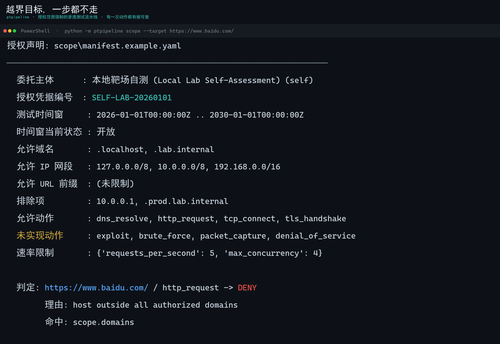
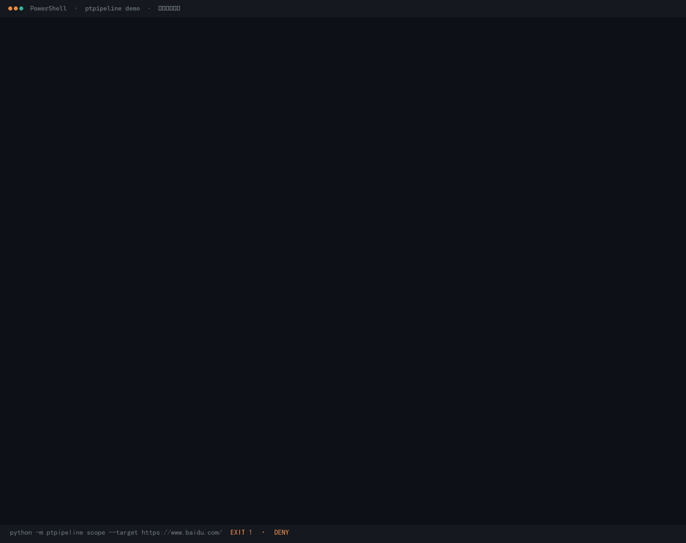
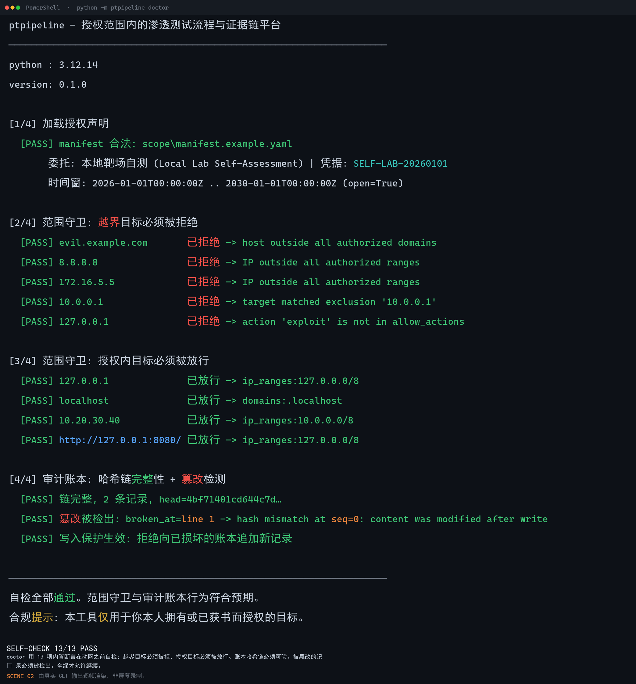
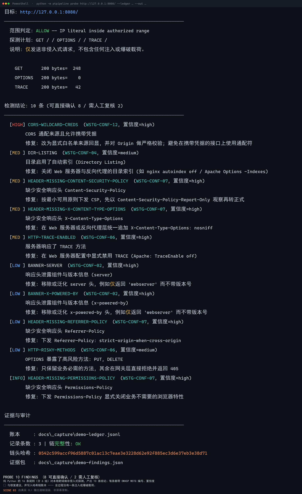
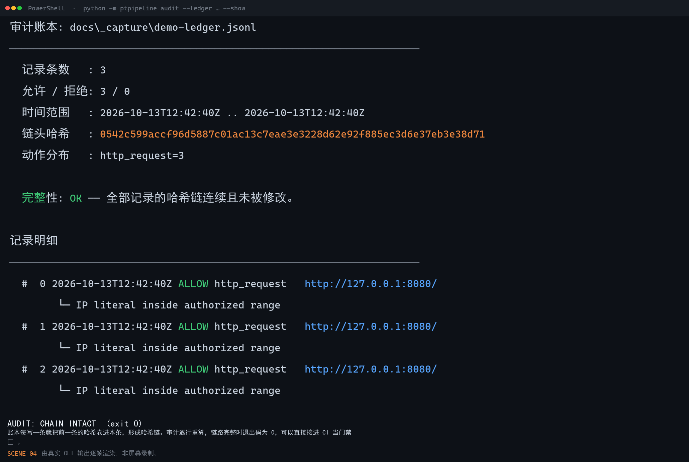
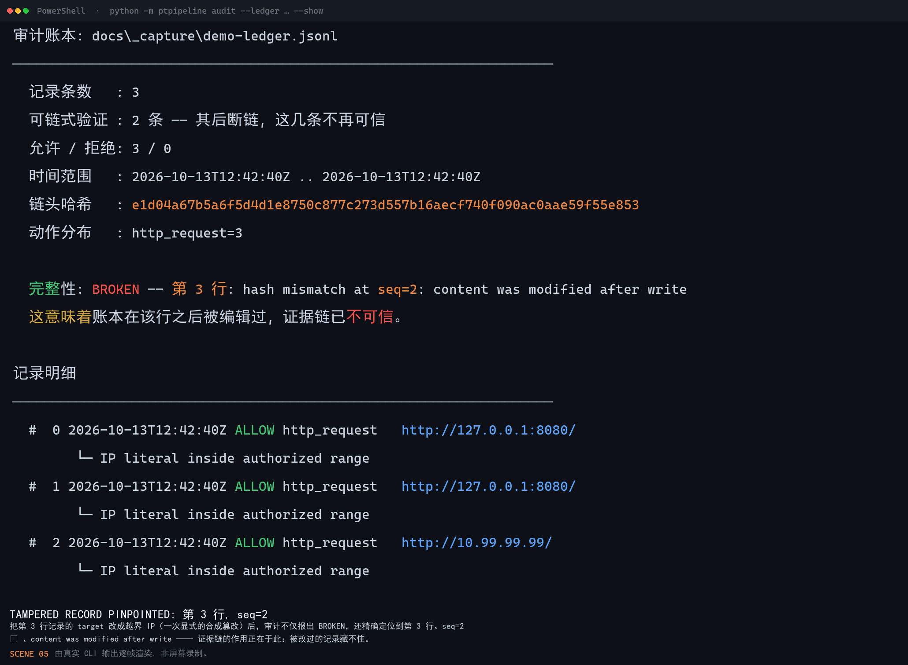
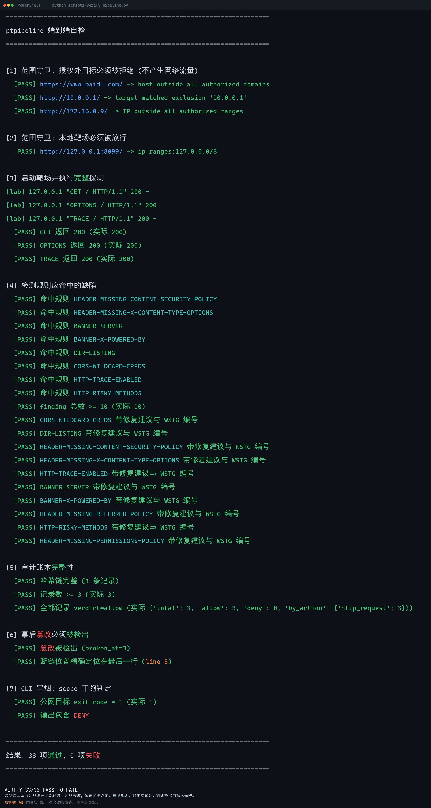

# ptpipeline

> **授权范围内的渗透测试流程与证据链平台**
> 把"这次测试是在授权范围内做的，而且结论可复现"从一句口头承诺，变成一条**机器可验证**的属性。

<p align="left">
  
  
  
</p>



---

## 看一眼它拦住了什么

上面这一屏是 `python -m ptpipeline scope --target https://www.baidu.com/` 的真实输出：授权声明里没有 `.baidu.com`，于是这个目标在**发出任何一个字节的网络请求之前**就被判为 `DENY`，理由与命中的规则（`scope.domains`）一并打印出来。注意最后一屏的 `未实现动作` —— `exploit` / `brute_force` / `packet_capture` 不是在白名单里被禁掉，而是**在代码里根本没有实现**。

---

## 这个项目解决什么问题

渗透测试行业里有两句几乎无法验证的话：

1. **"我只测了授权范围内的目标。"** —— 除了测试员的自觉，没有任何技术手段能证明。
2. **"这个漏洞确实存在。"** —— 报告里写着结论，但复现它往往要靠几个月前的记忆和一堆已失效的截图。

`ptpipeline` 把这两个问题都变成**代码可强制、事后可验证**的事情：

- **授权范围是一段可执行代码**，不是一个 Word 文档。任何出站动作在发起前必须通过 `Guard.check()`；越界目标会在**握手之前**被拒绝，并留下"我尝试过、但被拦下了"的审计记录。
- **每一次动作都写进带哈希链的审计账本**。任何一条记录被事后编辑，都会导致其后所有记录的 `prev` 校验失败，`audit` 命令会精确指出断链在**第几行**。

> 这不是又一个扫描器。扫描器已经太多了。这个项目做的是**治理层与证据层**——把已有的工具约束在授权边界内，并让它们说的话变得可信。

---

## 60 秒上手（零依赖）

不需要 `pip install`，不需要虚拟环境，不需要 Docker。运行时依赖为 **0**，只用 Python 标准库。

```bash
git clone https://github.com/lhu89022-lab/ptpipeline
cd ptpipeline

# Windows
set PYTHONPATH=src
python -m ptpipeline doctor

# Linux / macOS
PYTHONPATH=src python -m ptpipeline doctor
```

`doctor` 会自证工具本身是可信的（**13 项断言**，含一次真实的篡改检测）：

```
ptpipeline — 授权范围内的渗透测试流程与证据链平台
────────────────────────────────────────────────────────────────────
python : 3.12.14
version: 0.1.0

[1/4] 加载授权声明
  [PASS] manifest 合法: scope\manifest.example.yaml
       委托: 本地靶场自测 (Local Lab Self-Assessment) | 凭据: SELF-LAB-20260101
       时间窗: 2026-01-01T00:00:00Z .. 2030-01-01T00:00:00Z (open=True)

[2/4] 范围守卫: 越界目标必须被拒绝
  [PASS] evil.example.com       已拒绝 -> host outside all authorized domains
  [PASS] 8.8.8.8                已拒绝 -> IP outside all authorized ranges
  [PASS] 172.16.5.5             已拒绝 -> IP outside all authorized ranges
  [PASS] 10.0.0.1               已拒绝 -> target matched exclusion '10.0.0.1'
  [PASS] 127.0.0.1              已拒绝 -> action 'exploit' is not in allow_actions

[3/4] 范围守卫: 授权内目标必须被放行
  [PASS] 127.0.0.1              已放行 -> ip_ranges:127.0.0.0/8
  [PASS] localhost              已放行 -> domains:.localhost
  [PASS] 10.20.30.40            已放行 -> ip_ranges:10.0.0.0/8
  [PASS] http://127.0.0.1:8080/ 已放行 -> ip_ranges:127.0.0.0/8

[4/4] 审计账本: 哈希链完整性 + 篡改检测
  [PASS] 链完整, 2 条记录, head=4bf71401cd644c7d…
  [PASS] 篡改被检出: broken_at=line 1 -> hash mismatch at seq=0: content was modified after write
  [PASS] 写入保护生效: 拒绝向已损坏的账本追加新记录

────────────────────────────────────────────────────────────────────
自检全部通过。范围守卫与审计账本行为符合预期。
合规提示: 本工具仅用于你本人拥有或已获书面授权的目标。
```

> 上方是本机实际运行输出，**逐字一致**——路径全部相对仓库根，不含任何本机信息。唯一每次运行都会变的是 `head=` 哈希：自检账本把真实时间戳入哈希。上面这一行取自本次采集，可对照 [docs/02-doctor.png](docs/02-doctor.png) 复核。

---

## 动图：一条完整的证据链是怎么走完的



四步走完一条闭环：**越界目标被 `DENY`** → **授权内的靶场探出 10 条配置缺陷** → **账本哈希链完整** → **把账本第 3 行悄悄改掉之后，`audit` 精确报出 `BROKEN —— 第 3 行: hash mismatch at seq=2`**。最后一步是整段演示的重点：篡改不是"可能被发现"，而是定位到具体行号。

> **诚实标注**：这个 GIF **不是屏幕录制**，而是用 Pillow 把 CLI 的**真实运行输出**逐帧渲染成终端风格画面生成的（脚本见 [`docs/build_assets.py`](docs/build_assets.py)，可一条命令复现）。画面里的每一个字符都来自真实 stdout，没有任何一帧是手工编造的文本。

<details>
<summary>逐步对照的静态图（点开看每一屏）</summary>

<br>

**① `scope`：越界目标当场拒绝** —— `python -m ptpipeline scope --target https://www.baidu.com/`


**② `doctor`：工具自证可信（13 项断言，含一次真实的篡改检测）** —— `python -m ptpipeline doctor`



**③ `probe`：10 条检测结论与逐条修复建议** —— `python -m ptpipeline probe http://127.0.0.1:8080/`



**④ `audit`：哈希链完整** —— `python -m ptpipeline audit --ledger docs/_capture/demo-ledger.jsonl --show`



**⑤ `audit`：篡改被精确定位到行** —— `python -m ptpipeline audit --ledger docs/_capture/demo-ledger.jsonl`



**⑥ `verify_pipeline.py`：端到端 33 项断言** —— `PYTHONPATH=src python scripts/verify_pipeline.py`



</details>

---

## 完整演示（对着本项目自带的靶场跑一遍）

```bash
# 1) 启动一个"故意配错"的本地靶场（只监听回环）
python labs/vulnerable_server.py --port 8080

# 2) 试一个授权范围之外的目标 —— 当场拒绝，不发出任何网络请求
python -m ptpipeline scope --target "https://www.baidu.com/"
#   判定: https://www.baidu.com/ / http_request -> DENY
#         理由: host outside all authorized domains
#         命中: scope.domains

# 3) 对授权范围内的靶场做非侵入式配置检测
python -m ptpipeline probe "http://127.0.0.1:8080/" --out evidence/sample-findings.json
#   范围判定: ALLOW —— IP literal inside authorized range
#   检测结论: 10 条 (可直接确认 8 / 需人工复核 2)

# 4) 校验证据链
python -m ptpipeline audit --show
#   完整性: OK —— 全部记录的哈希链连续且未被修改。
```

真实输出（`probe` 命中本项目靶场故意设置的 10 个缺陷）：

| 严重度 | 规则 | WSTG | 置信度 |
|--------|------|------|--------|
| HIGH | `CORS-WILDCARD-CREDS` CORS 通配来源且允许携带凭据 | WSTG-CONF-12 | high |
| MED | `DIR-LISTING` 目录启用自动索引 | WSTG-CONF-04 | medium |
| MED | `HEADER-MISSING-CONTENT-SECURITY-POLICY` 缺少 CSP | WSTG-CONF-07 | high |
| MED | `HEADER-MISSING-X-CONTENT-TYPE-OPTIONS` | WSTG-CONF-07 | high |
| MED | `HTTP-TRACE-ENABLED` 服务器响应 TRACE 方法 | WSTG-CONF-06 | high |
| LOW | `BANNER-SERVER` 响应头泄露组件版本 | WSTG-CONF-02 | high |
| LOW | `BANNER-X-POWERED-BY` | WSTG-CONF-02 | high |
| LOW | `HEADER-MISSING-REFERRER-POLICY` | WSTG-CONF-07 | high |
| LOW | `HTTP-RISKY-METHODS` OPTIONS 暴露 PUT/DELETE | WSTG-CONF-06 | medium |
| INFO | `HEADER-MISSING-PERMISSIONS-POLICY` | WSTG-CONF-07 | high |

---

## 核心设计

### 1. 授权范围守卫（`src/ptpipeline/core/scope.py`）

授权声明是一份 YAML，包含**时间窗、域名、IP 网段、排除项、动作白名单、速率上限**：

```yaml
authorization:
  engagement: "本地靶场自测 (Local Lab Self-Assessment)"
  contract_ref: "SELF-LAB-20260101"          # 书面授权凭据编号
  window_start: "2026-01-01T00:00:00Z"       # 时间窗外一律拒绝
  window_end:   "2030-01-01T00:00:00Z"

scope:
  domains:   [".localhost", ".lab.internal"] # 前导点 = 该域及其全部子域
  ip_ranges: ["127.0.0.0/8", "10.0.0.0/8", "192.168.0.0/16"]
  exclusions: ["10.0.0.1", ".prod.lab.internal"]  # 优先级高于一切 allow 规则
  allow_actions: [dns_resolve, tcp_connect, http_request, tls_handshake]
  rate_limit: { requests_per_second: 5, max_concurrency: 4 }
```

判定顺序（**排除项永远优先**）：

```
时间窗 → 动作白名单 → 目标解析 → 排除项 → URL 前缀 → IP 网段 → 域名规则
```

三条容易被忽略但很关键的实现细节：

- **`allow_actions` 里没有 `exploit` / `brute_force` / `packet_capture`** —— 这些动作在代码里**根本不存在实现**。这是一个诚实的设计约束：本项目在结构上就无法被用作攻击工具。
- **IP 字面量走网段校验，不走域名匹配**。`http://127.0.0.1:8080/` 的主机名是字面 IP，若按域名规则匹配会因不属于任何 `domains` 条目而被误拒（这是开发过程中实际抓到的一个 bug，见下文"踩过的坑"）。
- **`Guard.check()` 永不抛异常**，一律返回 `Decision`。拒绝是正常控制流的一部分，必须能被记录、被统计、被展示。

### 2. 哈希链审计账本（`src/ptpipeline/core/audit.py`）

```
rec_0.prev = "0" * 64
rec_n.prev = rec_{n-1}.hash
rec_n.hash = sha256( canonical_json(rec_n without hash) + rec_n.prev )
```

`canonical_json` = 键排序 + 紧凑分隔符 + `ensure_ascii=True`，保证跨平台哈希一致。每条记录含 `seq / ts(UTC) / actor(主机#PID) / mode / target / action / verdict / reason / matched_rule / prev / hash`。

两个刻意的行为设计：

- **续写已损坏的账本会直接抛错**（`strict=True`）。绝不把新证据接到一条已经不可信的链上。
- **取证模式**（`strict=False`）允许打开损坏的账本以定位断链位置。写入保护与取证能力分离。

### 3. 非侵入式检测（`src/ptpipeline/checks/probe.py`）

只发送 `GET` / `OPTIONS` / `TRACE` 三类**非侵入式**请求，只读取响应头与公开响应体标记。**不发送任何注入载荷、不做爆破、不做越权尝试、不做文件上传**。

每条 finding 携带 `rule_id / severity / confidence / wstg_id / remediation / evidence`：

- `confidence` 区分"可直接确认"（`high`，如 `X-Content-Type-Options` 头缺失，一次请求即可判定）与"需人工复核"（`medium` / `low`，如 `Access-Control-Allow-Origin` 返回了具体来源，单次请求无法区分"固定白名单"与"任意来源反射"）。`probe` 的结论行直接按这个语义拆分：`检测结论: N 条 (可直接确认 X / 需人工复核 Y)`，不做笼统的"全部需人工复核"——那等于把已经确定的结论也说成不确定。
- 报告里的每一句结论都能追溯到 `evidence` 字段中的原始响应片段。

---

## 目录结构

```
pentest-ops-kit/
├── pyproject.toml                  # 打包 / ruff / pytest 配置
├── README.md
├── PLAN.md                         # 实现方案：模块划分、数据结构、六周排期
├── DESIGN-NOTES.md                 # 设计取舍：为什么这么做、刻意不做什么
├── LICENSE                         # MIT
├── scope/
│   └── manifest.example.yaml       # 授权声明：唯一授权来源
├── src/ptpipeline/
│   ├── __init__.py
│   ├── __main__.py                 # CLI: doctor / scope / audit / probe
│   ├── core/
│   │   ├── scope.py                # 授权范围守卫（核心不变量）
│   │   └── audit.py                # 哈希链审计账本
│   └── checks/
│       └── probe.py                # 非侵入式配置检测（6 组规则 / 16 条规则 ID）
├── labs/
│   └── vulnerable_server.py        # 故意配错的本地靶场（仅监听回环）
├── scripts/
│   └── verify_pipeline.py          # 端到端自检：33 项断言
└── evidence/                       # 证据包与账本（默认不入版本控制）
```

为什么这么设计、刻意不做什么，见 [`DESIGN-NOTES.md`](DESIGN-NOTES.md)；具体怎么实现，见 [`PLAN.md`](PLAN.md)。

---

## 自检

```bash
PYTHONPATH=src python scripts/verify_pipeline.py
```

覆盖 7 组、33 项断言：授权外目标拒绝 → 授权内放行 → 起靶场做完整探测 → 8 条规则必须命中 → 账本链完整 → **事后篡改必须被精确定位** → CLI 退出码契约。

```
[6] 事后篡改必须被检出
  [PASS] 篡改被检出 (broken_at=3)
  [PASS] 断链位置精确定位在最后一行 (line 3)

结果: 33 项通过, 0 项失败
```

---

## 开发过程中真实抓到的问题

记录下来是因为它们恰好是**只有真跑起来才会暴露**的一类缺陷：

| # | 现象 | 根因 | 修复 |
|---|------|------|------|
| 1 | `http://127.0.0.1:8080/` 被误判为越界 | URL 主机名是 IP 字面量，却走了域名匹配路径 | 分离 `literal_ip` 判定，IP 字面量一律走网段校验 |
| 2 | 目录索引规则完全漏检（9 条而非 10 条） | `recv(4096)` 把响应头与正文一起读回，缓冲区被整体丢弃后又重新 `recv`，正文已被消费 | 改为"读到头结束标记为止、原样返回缓冲区"，由 `_split_head_body` 切分，`_read_body` 补齐剩余 |
| 3 | 无法审计一个已损坏的账本 | 构造函数在 `strict` 模式下无条件抛错，取证场景被自己挡住 | 引入 `strict=False` 取证模式 + 独立写入保护 |

---

## 路线图

- [x] **M1 授权边界**：manifest 解析 + Guard 判定 + 13 项自检
- [x] **M2 证据链**：哈希链账本 + 篡改定位 + 写入保护
- [x] **M3 检测与归约**：16 条 WSTG 映射规则 + 严重度/置信度分级 + 证据包导出
- [ ] **M4 报告生成**：Jinja2 模板 → Markdown / HTML，执行摘要 + 技术详情 + 复现步骤
- [ ] **M5 复测引擎**：从证据包重放历史 finding，输出 `fixed / still-open / changed` 三态对比
- [ ] **M6 流量归因**：把 pcap 中的 HTTP 请求与审计账本逐条对齐，输出 `matched / ledger_only / traffic_only` 三类结果（纯标准库解析 classic pcap + pcapng，不解密 TLS）

---

## 合规边界

本项目**只允许**用于你本人拥有、或已获得**书面授权**的目标。

- 默认配置中的目标全部是 RFC1918 私有地址与本机回环，**请勿改为公网资产**。
- `labs/vulnerable_server.py` 是故意配置错误的演示服务，**仅监听 `127.0.0.1`，禁止对公网暴露**。
- 工具在结构上不包含任何漏洞利用、暴力破解、拒绝服务或流量嗅探能力，`allow_actions` 也显式排除了这些动作。
- 未经授权对他人系统进行安全测试在《中华人民共和国刑法》第二百八十五条、第二百八十六条项下可能构成犯罪。**取得书面授权，是开始工作的前提，不是事后补的手续。**

## 许可

[MIT](LICENSE) © 2026 Hu Zhanlin
